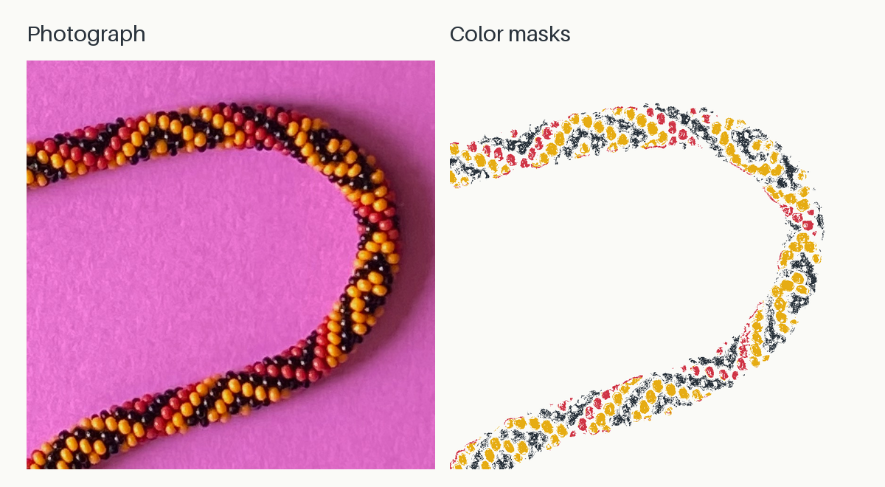

# Bead Map

Python experiments for detecting bead regions and tracing bracelet structure
from color masks.



The project image pairs the photograph with the same crop of the three existing
masks, recolored on a light background. The central bend keeps individual beads
visible at project-card size while making the correspondence easy to follow.
These are intermediate color selections, not a validated bead map or a completed
reconstruction. The original masks were selected by hand using
[hsv_tools](https://github.com/rharriszzz/hsv_tools/blob/main/hsv_picker.py),
as noted in `bracelet-pattern-extractor.py`.

## Regenerate the image

From the repository root, with Python 3.10 or newer:

```sh
python3 -m pip install 'Pillow==12.1.1'
python3 scripts/generate_bead_map_figures.py
```

The figure script needs only Pillow; the analysis experiments use
`requirements.txt`. All figure inputs are committed here, so regeneration needs
no network access after installing Pillow. Use `--output-dir /tmp/bead-map-figures`
to generate a separate copy.

- [Project card](docs/figures/bead-map-card.png): 1200 × 660 pixels.
- [Small preview](docs/figures/bead-map-card-400.png): 400 × 220 pixels.
- [Candidate review sheet](docs/figures/bead-map-candidates.png): three crops,
  each shown at full size and at 400 pixels wide. The first, “bend,” is selected.

Both panels use source-pixel crop `(1030, 1330, 1900, 2200)` (left, top,
right, bottom). Mask pixels below 128 are foreground, matching the polarity
used by `view_combined_masks.py`. Yellow, red, and black selections are painted
in that order; black takes precedence where masks overlap. No regions are
filled, removed, or inferred. Both panels receive the same Lanczos downsampling.

## Photograph provenance

The unchanged [source photograph](docs/figures/source/beads-photo-2.jpg) was copied
from the committed `beads-photo-2.jpg` in
[`rharriszzz/beads` at commit 628351437842b2ecd05f8a1765d17449fbea61f9](https://github.com/rharriszzz/beads/blob/628351437842b2ecd05f8a1765d17449fbea61f9/beads-photo-2.jpg).
Its Git blob is `492a1cbb184eb31f1d54fba063e680b23d8510c9`; its SHA-256 is
`eb7c9edb62f5580ef56632872da48da92556d62b758295137068cc2404dc8fbb`.
The three mask JPEGs are the existing files in this repository. All four images
are 2540 × 3182 pixels and share the same coordinates.
